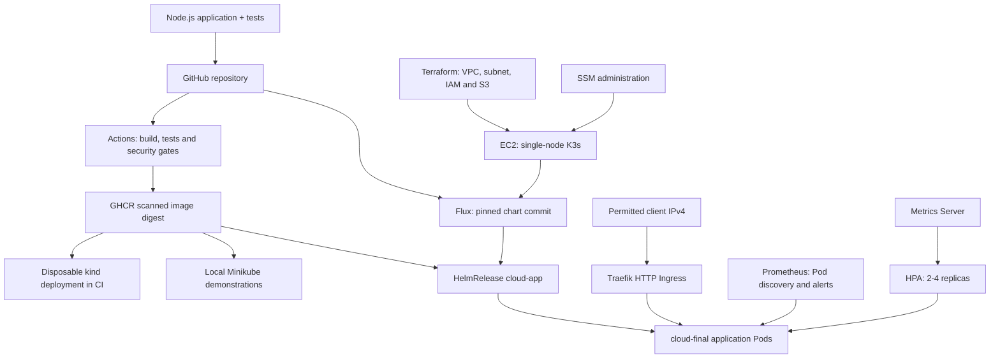
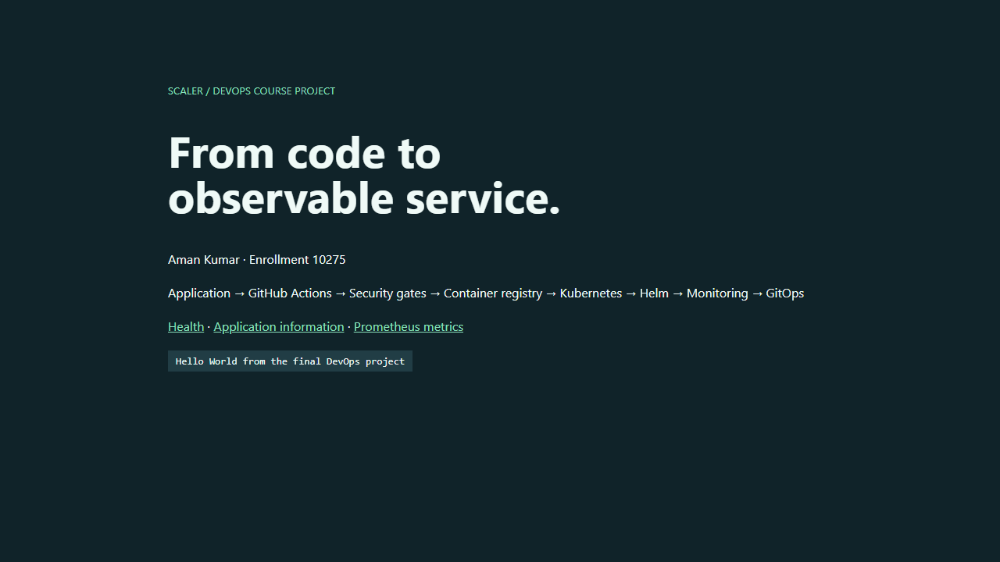
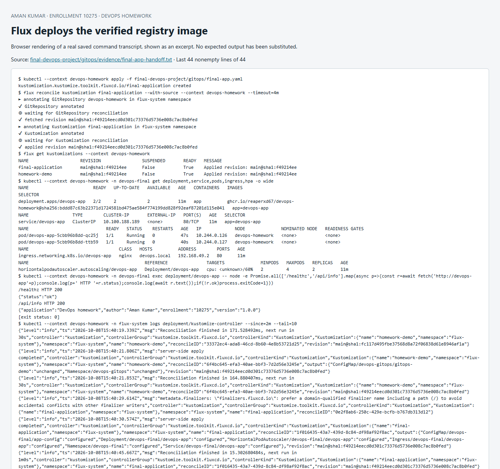

# Session 21 — Final DevOps project

**Aman Kumar · Enrollment 10275**

This project carries one HTTP application through source control, tests, security gates, Docker publishing, Kubernetes, Helm, monitoring, GitOps and failure recovery. Local and CI demonstrations are verified. On 14 October 2026, the integrated AWS deployment also passed application, monitoring and automatic GitOps drift-recovery checks, recorded in the [live cloud transcript](terraform/evidence/aws-live.txt). All 20 final-project AWS resources were then destroyed and cleanup was independently verified; the recorded cloud endpoint is no longer live.

## Architecture



The delivery environments have separate owners and evidence. Local raw manifests use `devops-final`; the local Helm exercise uses `devops-final-helm`; AWS uses a separate K3s cluster with a Flux-owned Helm release in `cloud-final`. The local Compose monitoring stack runs another instance of the application image. Cloud infrastructure provisioning and successful application bootstrap are checked independently.

## Technology and source map

| Area | Files and evidence |
|---|---|
| Application | [Node.js server and five HTTP tests](application) |
| Docker | [Multi-stage Dockerfile](docker/Dockerfile) |
| Kubernetes | [Deployment, Service, ConfigMap, Secret template, Ingress, HPA and probes](kubernetes) |
| Helm | [Chart and lifecycle evidence](helm/README.md) |
| Terraform and AWS | [Integrated cloud bootstrap, verification and cleanup](terraform/README.md), [live AWS log](terraform/evidence/aws-live.txt) |
| CI/CD | [Active root workflow](../.github/workflows/devsecops.yml), [execution evidence](../session-16-cicd/evidence/README.md) |
| Security | [Tools, configuration and gates](security/README.md) |
| Monitoring | [Prometheus, alerts and actual outage/recovery](monitoring/README.md) |
| GitOps | [Flux reconciliation and drift correction](gitops/README.md) |
| Troubleshooting | [Intentional failures, diagnosis, fixes and proof](troubleshooting/README.md) |

## Application and Docker setup

```sh
cd final-devops-project/application
npm ci --ignore-scripts
npm run build
npm test
npm start
# GET /, /healthz, /readyz, /api/info, /metrics
```

From `final-devops-project/`:

```sh
docker build -f docker/Dockerfile -t devops-final:local .
docker run --rm -p 127.0.0.1:8200:8080 devops-final:local
```

The Docker build runs the test suite. The runtime contains the Node executable and server, runs as an unprivileged user and excludes unused npm/Yarn package managers. The HTTP API never exposes its runtime token. Requests get a unique correlation ID, and logs omit query strings and request bodies.



## Local Kubernetes deployment

For an initial setup with Minikube on PATH, execute `kubernetes/deploy-local.ps1` (or pass `-Minikube <binary-path>`). It loads the image, creates a random runtime Secret, applies the manifests, switches to the local image and waits for rollout. The Secret value is never saved to Git. Once Flux owns the namespace, suspend its `final-application` Kustomization before manual image experiments and resume it afterward; otherwise the controller restores the Git version.

```sh
kubectl --context devops-homework -n devops-final get pods,svc,ingress,hpa
kubectl --context devops-homework -n devops-final top pods
kubectl --context devops-homework -n devops-final port-forward svc/devops-app 8201:80
curl http://localhost:8201/api/info
```

The [actual state output](kubernetes/evidence/state.txt) records the deployed service and HTTP response. Ingress requires a running ingress controller and the host header `devops.local`. HPA requires Metrics Server. Startup, readiness and liveness probes serve distinct purposes: allow initial startup, control traffic eligibility, and restart an unhealthy container. This app is stateless; `/tmp` uses `emptyDir`. Persistent storage is demonstrated separately in [Session 13](../session-13-storage-hpa/README.md).

## Local Helm lifecycle

The [Helm chart](helm/README.md) packages the same app with configurable image, version, replicas, probes, ingress and HPA. Its recorded exercise installs a release, runs a Service health test, upgrades the application configuration and rolls it back. It uses `devops-final-helm`, separate from the raw-manifest namespace.

## AWS, Terraform and cloud Kubernetes

The [Terraform root](terraform/README.md) reuses the Session 19 module and adds the [final-project bootstrap](terraform/bootstrap.sh.tftpl). It declares 20 AWS resources covering the VPC, subnet, Internet Gateway/routes, security rules, EC2, IAM instance role/profile and private versioned S3 bucket. The cloud host is an Amazon Linux 2023 `c7i-flex.large` with 2 vCPUs and 4 GiB memory. Its encrypted root volume and IMDSv2 configuration are part of the module.

The bootstrap installs K3s `v1.35.9+k3s1`, Flux `2.9.6` and Helm CLI `3.19.0`. Flux owns `cloud-app` in `cloud-final`, using chart commit `77166ce59eff8a2c6e02e189b56fe995c18ed1f0` and the previously scanned GHCR image digest recorded in the [Terraform outputs and deployment guide](terraform/README.md). A runtime-generated Secret stays outside Git and Terraform state. Traefik routes HTTP to the application; HPA is configured for 2–4 replicas; Prometheus discovers application Pods independently. SSM provides administration, with no public SSH or Kubernetes API rule. HTTP access is restricted to the configured learner `/32`.

To repeat the cloud workflow, follow [AWS authentication setup](../session-18-terraform/AWS-SETUP.md), set the ignored `local.auto.tfvars` client address, then run from the repository root:

```powershell
cd final-devops-project/terraform
python ../../scripts/terraform-login.py -- init
python ../../scripts/terraform-login.py -- plan -out=lab.tfplan
python ../../scripts/terraform-login.py -- show lab.tfplan
python ../../scripts/terraform-login.py -- apply lab.tfplan
python ../../scripts/terraform-login.py -- output
```

The [cloud guide](terraform/README.md#provision-and-verify) explains SSM access and running [verify-cloud.sh](terraform/verify-cloud.sh) on the host. A successful Terraform apply is only the infrastructure checkpoint: cloud-init must finish with `BOOTSTRAP_COMPLETE`, and the verification script must establish application readiness, the deployed digest, Flux/Helm status, usable metrics and healthy Prometheus targets.

The live verification recorded:

| Check | Observed result |
|---|---|
| Bootstrap and cluster | `BOOTSTRAP_COMPLETE`, active K3s service and a Ready `v1.35.9+k3s1` Node; Traefik and Metrics Server available |
| GitOps and Helm | GitRepository and HelmRelease Ready; `cloud-app` revision 1 deployed from chart `1.0.1+77166ce59eff` |
| Application | Two Ready Pods running the pinned GHCR digest; public `/healthz` and `/api/info` returned HTTP 200 and version `1.0.0-cloud` |
| Monitoring | Two application targets healthy, both `up=1`; `ApplicationDown` and `HighApplicationMemory` loaded with healthy, inactive rules |
| Resource metrics | `kubectl top pods` returned CPU and memory samples. HPA existed with limits 2–4; its initial CPU target was still `<unknown>`, so this run does not establish cloud autoscaling |
| Drift recovery | A manual ConfigMap change to `drift-demo` returned to `1.0.0-cloud` within 30 seconds, without forced reconciliation |

The cloud deployment did not run a Helm test hook, sustained load test or alert-triggering outage. Those separate local exercises are linked below. The screenshot shows the actual AWS-served page before teardown:


Earlier [mock-provider validation](terraform/evidence/validation.txt), [integrated Terraform checks](terraform/evidence/integrated-terraform-validation.txt) and [bootstrap checks](terraform/evidence/bootstrap-offline-validation.txt) remain separate from the live AWS log. Mocked identifiers are synthetic; offline rendering does not establish AWS or Kubernetes runtime success. This is an ephemeral single-node learning environment, with `emptyDir` metrics storage and no high-availability claim.

## CI/CD and DevSecOps

The workflow validates source, builds a tested image, rejects security findings, pushes to GHCR, deploys the commit-tagged artifact into kind, then checks health/API/metrics. Reports are uploaded on success or failure. See [Session 16](../session-16-cicd/README.md) for CI/CD concepts and [Session 17](../session-17-devsecops/README.md) for gates and the real image-vulnerability correction.

## Monitoring and GitOps evidence

The [local monitoring exercise](monitoring/README.md) demonstrated an alert firing during an intentional outage and clearing on recovery. JSON logs and request correlation IDs support diagnosis. The [Session 13 load exercise](../session-13-storage-hpa/README.md) separately demonstrated HPA scaling from one to four replicas and back. Neither result is presented as a cloud load or outage test. Distributed tracing is explained; no multi-service tracing backend was deployed.

In the local cluster, Flux demonstrated ConfigMap drift correction and then took ownership of the final application's manifests. [Local handoff evidence](gitops/evidence/final-app-handoff.txt) records two Ready Pods, the Git revision, image digest and HTTP 200 response. HPA manages replica count instead of GitOps continually resetting it.



The AWS exercise verified HelmRelease drift detection by changing `cloud-app-config` and observing automatic restoration within 30 seconds. Prometheus returned two healthy scrape targets, `up=1` for both Pods and both alert rules. The [AWS transcript](terraform/evidence/aws-live.txt) also records real Pod resource samples; its initial HPA CPU percentage remained unknown. Configured replica limits and available Pod metrics alone do not demonstrate scaling under load.

## Troubleshooting and lessons learned

[The final challenge](troubleshooting/README.md) intentionally breaks application delivery and networking, records investigation with cluster events/endpoints, then restores healthy behavior. The independent [Session 14 labs](../session-14-troubleshooting/README.md) cover further common failure modes.

The live cloud work exposed three additional issues; the failed attempts remain in the [AWS log](terraform/evidence/aws-live.txt):

| Failure | Root cause and implemented correction |
|---|---|
| EC2 request rejected by the account's Free plan | The requested `t3.medium` was ineligible. Querying AWS instance eligibility identified `c7i-flex.large` for this account and Region; eligibility is account-specific. |
| Bootstrap stopped with `no matching resources found` | The Kubernetes API responded before the kubelet registered its Node. Bootstrap now waits for a Node object to exist, then waits for its Ready condition. |
| Flux Helm installation rejected Kubernetes labels | Flux added a Git revision as SemVer build metadata, introducing `+` into `helm.sh/chart`. The chart helper now replaces `+` with `_` and bounds the label length; the cloud source is pinned to the corrected commit. |

- Check image contents as well as application dependencies: a minimal app can inherit vulnerable unused tools.
- A healthy Pod does not guarantee a working Service; selectors and endpoints must agree.
- A runtime Secret and a Git-managed manifest have different lifecycles; preserve that separation.
- Rollout completion and endpoint updates are asynchronous; wait for observable conditions.
- Validate infrastructure, bootstrap and application delivery separately; retain failed attempts and confirm recovery with observed state and HTTP responses.

## Cleanup

Use each local session's cleanup instructions for its namespaces, releases and Compose project. Cloud resources must be destroyed from the [same Terraform root and state](terraform/README.md#troubleshooting-and-cleanup) that created them. Destroying the EC2 host also removes its K3s cluster and ephemeral metrics.

The [live AWS log](terraform/evidence/aws-live.txt) records `Destroy complete! Resources: 20 destroyed.` and an empty Terraform state. Independent AWS queries confirmed all three final-project instances, including the two replaced during debugging, were terminated; the final VPC and lab-tagged EBS volumes were absent; and the artifact bucket returned `HeadBucket` 404. This cleanup is separate from the existing local environments. Screenshots and logs preserve the completed demonstration after teardown.

The following image renders selected lines from the actual command transcript; it is not an AWS Console screenshot.


