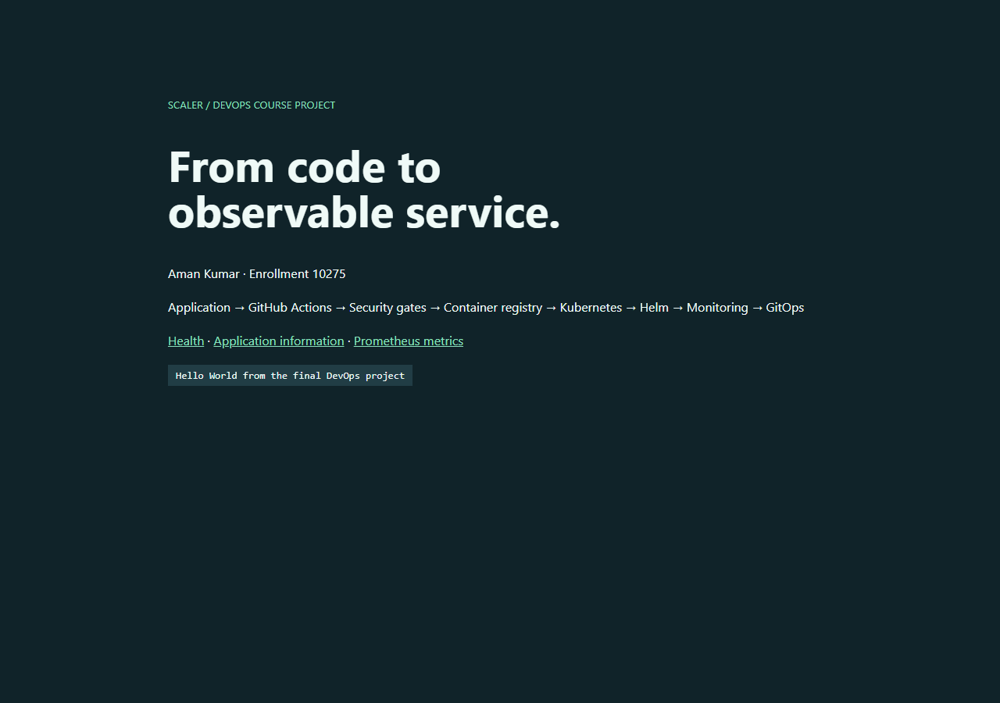
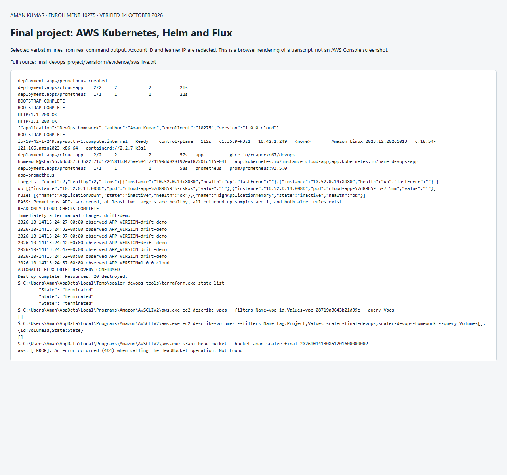
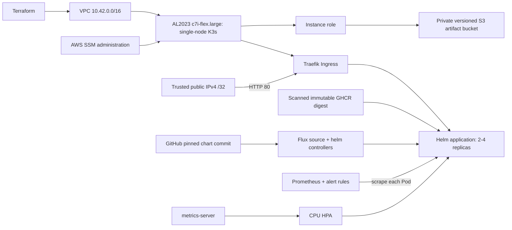

# Final project — Terraform and cloud Kubernetes

**Aman Kumar · Enrollment 10275**

This root connects the final project's existing image, Helm chart, GitOps reconciliation and monitoring on an ephemeral AWS host. It reuses the [Session 19 infrastructure module](../../session-19-cloud/modules/infrastructure/main.tf), with a final-project bootstrap override. Session 19 retains its Nginx demonstration.

**Completed in AWS ap-south-1 on 14 October 2026.** The final environment had 20 Terraform-managed resources. A fresh host completed the full bootstrap, served the application, passed monitoring checks and automatically recovered a manual ConfigMap change. All 20 resources were then destroyed; the historical URL is no longer active. [Complete live execution and cleanup log](evidence/aws-live.txt).

| Live result | Evidence recorded |
| --- | --- |
| Fresh bootstrap | cloud-init `done`; `BOOTSTRAP_COMPLETE` |
| Kubernetes / delivery | Ready K3s node, Flux source/release Ready, Helm chart `1.0.1+77166ce59eff`, two Ready app Pods |
| HTTP | Workstation `/healthz` and `/api/info` returned 200; version `1.0.0-cloud` |
| Monitoring | Two healthy targets; both `up=1`; two healthy inactive alert rules; CPU and memory samples |
| HPA | Configured for 2–4 replicas; initial target was still warming up. No cloud load-scaling claim |
| Automatic drift recovery | `APP_VERSION=drift-demo` restored to `1.0.0-cloud` within 30 seconds without a forced reconcile |
| Terraform consistency | Refresh plan reported no changes |
| Cleanup | 20 destroyed, empty state; all three final-host attempts terminated, VPC absent, tagged EBS volumes absent, S3 bucket returned 404 |

[Earlier local checks](evidence/validation.txt), [integrated Terraform checks](evidence/integrated-terraform-validation.txt), [eligible-host mock tests](evidence/eligible-host-mock-tests.txt) and [bootstrap/regression checks](evidence/bootstrap-offline-validation.txt) remain separate from live evidence. The cloud exercise did not perform an additional Helm test, load test or alert outage; those workflows have separate local evidence elsewhere in the final project.





## Architecture



Terraform creates 20 AWS resources: VPC/subnet/IGW/routes/security rules, EC2, role/profile/policies, and a private S3 bucket with versioning, AES256 encryption, ownership controls, public-access blocking and TLS-only policy. The final host is `c7i-flex.large` (2 vCPU, 4 GiB), with an encrypted 12 GiB gp3 root volume. Resources use `aman-scaler-final`; the Region defaults to `ap-south-1`. This instance type was selected after the account's Free plan rejected `t3.medium`; the AWS instance-type API reported `c7i-flex.large` eligible and available in the Region. Eligibility, credits and charges depend on the account's plan and usage.

The [bootstrap](bootstrap.sh.tftpl) installs K3s `v1.35.9+k3s1`, Flux `2.9.6`, and Helm CLI `3.19.0`. K3s uses Pod CIDR `10.52.0.0/16`, Service CIDR `10.53.0.0/16` and DNS `10.53.0.10`, separate from the VPC. The kubeconfig is root-only. AL2023's default permissive SELinux mode is retained; the script fails on an enforcing host instead of changing its policy. The installer skips the incompatible automatic EL8 policy RPM path.

Flux owns one Helm release, `cloud-app`, in `cloud-final`. It fetches the existing chart at commit `77166ce59eff8a2c6e02e189b56fe995c18ed1f0`, so provisioning does not depend on a future Git commit. The post-renderer pins both application and test-hook containers to:

```text
ghcr.io/reaperxd67/devops-homework@sha256:bddd87c63b22371d1724581bd475ae584f774199dd828f92eaf87201d115e041
```

This is the image recorded in the earlier [CI/security and GitOps evidence](../gitops/README.md). The chart runs UID 1000, a read-only root filesystem, dropped capabilities, `/healthz` and `/readyz` probes, and CPU requests for HPA. A random `app-secret` is generated on the host at runtime; its value is absent from Git, Terraform state and bootstrap logs. HPA maintains 2–4 replicas. Traefik exposes a catch-all HTTP route. Neither SSH nor the Kubernetes API is publicly opened. HTTP is limited to the supplied learner `/32`; Prometheus remains ClusterIP-only.

Prometheus `v3.5.0` discovers each application Pod independently using namespace-scoped read-only RBAC. It evaluates `ApplicationDown` and `HighApplicationMemory` rules. Its short-lived data uses `emptyDir` and one-hour retention; destroying/replacing this demonstration host discards the cluster and metrics. This single-node lab is not highly available.

## Offline checks

From the repository root, with Terraform, Helm, kubectl, Bash and Python/PyYAML available:

```powershell
terraform -chdir=final-devops-project/terraform init -backend=false
terraform -chdir=final-devops-project/terraform fmt -check -recursive
terraform -chdir=final-devops-project/terraform validate
terraform -chdir=final-devops-project/terraform test
terraform -chdir=session-19-cloud/modules/infrastructure init -backend=false
terraform -chdir=session-19-cloud/modules/infrastructure test
python final-devops-project/terraform/verify-bootstrap.py
```

The Python checker accepts `--terraform`, `--helm`, `--kubectl` and `--bash` executable paths. It evaluates Terraform locals in a temporary provider-free folder, enforces the 16 KiB raw EC2 user-data limit, checks Bash syntax/YAML, renders the chart and verifies the Kustomize digest rewrite. Terraform mock tests also reject mutable image references, unpinned chart sources and oversized user data. They make no AWS calls.

## Provision and verify

Complete [AWS setup](../../session-18-terraform/AWS-SETUP.md). Use the authenticated CLI profile already configured on your machine; do not put credentials in HCL. The pinned AWS provider uses an older SDK that cannot directly read the newer `aws login` profile format. [terraform-login.py](../../scripts/terraform-login.py) exports temporary credentials privately into the Terraform child process, without printing or saving them. AWS CLI commands continue to use `AWS_PROFILE=scaler-lab`. Refresh an expired session with `aws login --profile scaler-lab`.

Create an ignored `local.auto.tfvars` in this folder containing your current public IPv4 `/32` as `allowed_http_cidr`. The documentation default `203.0.113.10/32` cannot reach the application. Confirm the planned account, Region, instance size and resource count before applying.

```powershell
cd final-devops-project/terraform
$env:AWS_PROFILE = 'scaler-lab'
$awsCliPath = "$env:LOCALAPPDATA\Programs\Amazon\AWSCLIV2\aws.exe"
& $awsCliPath sts get-caller-identity
python ../../scripts/terraform-login.py -- init
python ../../scripts/terraform-login.py -- plan '-out=lab.tfplan'
python ../../scripts/terraform-login.py -- show lab.tfplan
python ../../scripts/terraform-login.py -- apply lab.tfplan
python ../../scripts/terraform-login.py -- output
$instanceId = python ../../scripts/terraform-login.py -- output -raw instance_id
& $awsCliPath ssm start-session --target $instanceId
```

SSM session administration and Run Command require operator permissions beyond the Terraform provisioning permissions. The EC2 runtime role already receives `AmazonSSMManagedInstanceCore` and a bucket-scoped S3 read policy from Terraform. It does not need Terraform administrator permissions.

After connecting through SSM, become root and wait for cloud-init:

```bash
sudo -i
cloud-init status --wait
tail -n 60 /var/log/scaler-cloud-bootstrap.log
export KUBECONFIG=/etc/rancher/k3s/k3s.yaml
kubectl get nodes
flux get sources git -A
flux get helmreleases -A
helm list -n cloud-final
kubectl -n cloud-final get deployment,pod,service,ingress,hpa
curl --fail http://127.0.0.1/healthz
curl --fail http://127.0.0.1/readyz
```

The bootstrap log must end in `BOOTSTRAP_COMPLETE`; `terraform apply` alone does not establish that cloud-init succeeded. Run [verify-cloud.sh](verify-cloud.sh) as root through an SSM session or `AWS-RunShellScript` to capture nodes, image digest, Flux/Helm status, HPA/Pod metrics, HTTP probes, Prometheus targets and alert rules. It contains read-only checks and does not print Secret contents. Allow a short metrics warm-up before collecting HPA evidence. Get the URL with `python ../../scripts/terraform-login.py -- output -raw website_url` and test it from the permitted workstation too.

For a safe GitOps drift exercise, change only the ConfigMap's `APP_VERSION`, then wait for Flux to restore `1.0.0-cloud`:

```bash
kubectl -n cloud-final patch configmap cloud-app-config --type merge -p '{"data":{"APP_VERSION":"drift-demo"}}'
kubectl -n cloud-final get configmap cloud-app-config -o jsonpath='{.data.APP_VERSION}{"\n"}'
# Observe the controller's scheduled reconciliation; do not force it.
for attempt in $(seq 1 36); do
  value=$(kubectl -n cloud-final get configmap cloud-app-config -o jsonpath='{.data.APP_VERSION}')
  printf '%s APP_VERSION=%s\n' "$(date --iso-8601=seconds)" "$value"
  [ "$value" = '1.0.0-cloud' ] && break
  sleep 5
done
[ "$value" = '1.0.0-cloud' ]
kubectl -n flux-system logs deployment/helm-controller --since=3m
```

Capture the changed value and the restored value. This edits ConfigMap data without restarting the existing healthy application Pods. The initial bootstrap manifest itself is Terraform-managed user data; Flux reconciles the chart source/release and detects drift in that release. This setup does not claim that every Kubernetes object is managed by GitOps.

## Troubleshooting and cleanup

The retained live log includes three issues resolved before completion: the account rejected `t3.medium`, so the final configuration uses an API-confirmed eligible x86 host; K3s needed a bounded node-registration wait before readiness; and Flux chart build metadata required sanitizing `+` in Helm labels. The corrected setup was verified on a freshly provisioned host. During drift correction, a transient Flux condition-update conflict retried automatically; the restored ConfigMap and subsequent in-sync log confirmed recovery.

The account remained on its Free plan. No plan upgrade was performed. Teardown followed verification to stop further lab resource usage; screenshots and logs preserve the completed exercise.

If bootstrap fails, inspect `/var/log/scaler-cloud-bootstrap.log`, `/var/log/cloud-init-output.log`, `journalctl -u k3s`, and Pod events through SSM. Package/image downloads require outbound TCP 80/443; DNS uses AmazonProvidedDNS. Check the pinned repository revision and GHCR image access for source/image failures. Do not open port 6443 or SSH to bypass an SSM problem. Updating user data replaces the instance because `user_data_replace_on_change` is enabled.

After collecting actual evidence, destroy from this Terraform root and confirm state is empty:

```powershell
python ../../scripts/terraform-login.py -- plan -destroy '-out=destroy.tfplan'
python ../../scripts/terraform-login.py -- show destroy.tfplan
python ../../scripts/terraform-login.py -- apply destroy.tfplan
python ../../scripts/terraform-login.py -- state list
```

The artifact bucket has `force_destroy = false`; remove only lab-owned objects and all their versions/delete markers if you added any. Each exercise has independent Terraform state: destroying this root does not destroy Session 18/19 resources. Never publish state, plans, credentials, kubeconfigs or Secret values.

References: [K3s requirements](https://docs.k3s.io/installation/requirements), [K3s server configuration](https://docs.k3s.io/cli/server), [AL2023 SELinux defaults](https://docs.aws.amazon.com/linux/al2023/ug/selinux.html), [Flux HelmRelease](https://fluxcd.io/flux/components/helm/helmreleases/), [Prometheus Kubernetes discovery](https://prometheus.io/docs/prometheus/latest/configuration/configuration/#kubernetes_sd_config).
