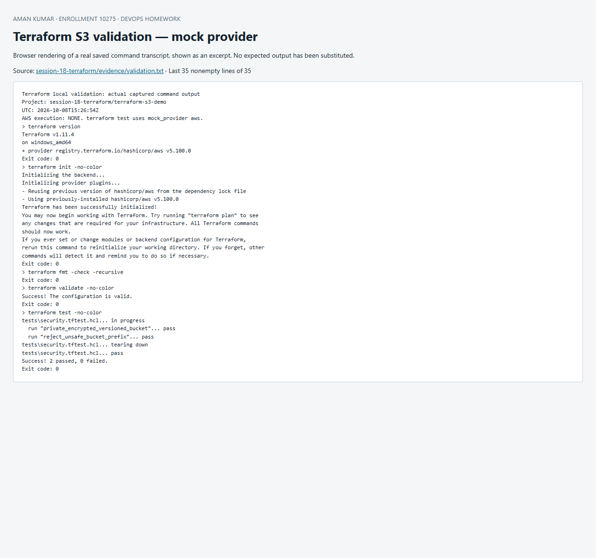
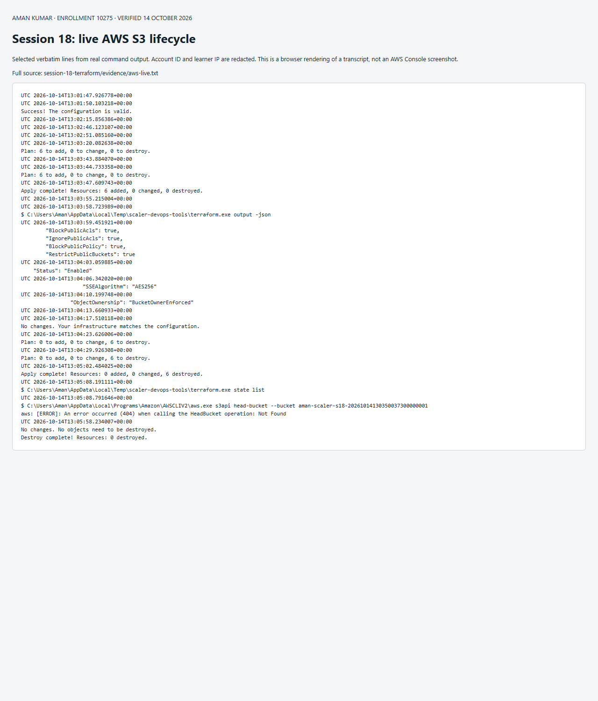

# Session 18 — Terraform & Infrastructure as Code

**Aman Kumar · Enrollment 10275**

The S3 project was deployed, verified and removed in **AWS ap-south-1 on 14 October 2026**. Terraform created six resources, the AWS API confirmed the bucket's security settings, and a second plan reported no changes. Applying the reviewed destroy plan removed all six resources; Terraform state was empty and `HeadBucket` returned the expected `404 Not Found` afterward. [Full live AWS transcript](evidence/aws-live.txt).

| Live check | Recorded result |
| --- | --- |
| Plan and apply | 6 added, 0 changed, 0 destroyed |
| Public access and ownership | All four access blocks enabled; `BucketOwnerEnforced` |
| Versioning and encryption | Versioning `Enabled`; SSE-S3 `AES256` |
| Transport policy | Explicit deny when `aws:SecureTransport` is false |
| Refresh plan | No changes; exit code 0 |
| Cleanup | 6 destroyed; empty state; bucket no longer found |

| Assignment deliverable | Submission |
| --- | --- |
| S3 Terraform project and full workflow | [terraform-s3-demo/README.md](terraform-s3-demo/README.md) |
| IAM governance | [01-iam/README.md](aws-services/01-iam/README.md) |
| EC2 compute | [02-ec2/README.md](aws-services/02-ec2/README.md) |
| S3 storage | [03-s3/README.md](aws-services/03-s3/README.md) |
| VPC networking | [04-vpc/README.md](aws-services/04-vpc/README.md) |
| DynamoDB and RDS | [05-dynamodb-rds/README.md](aws-services/05-dynamodb-rds/README.md) |
| AWS login and temporary credentials | [AWS-SETUP.md](AWS-SETUP.md) |

Infrastructure as Code stores the intended infrastructure in reviewable text. Terraform compares configuration, state and provider observations, builds a dependency graph, proposes a plan and applies the selected changes. The provider lock file pins the dependency selected during initialization; state tracks managed resource identities and belongs outside Git.

The examples use AWS provider 5.100.x and Terraform >=1.7; the validation transcript records Terraform 1.11.4. See the [S3 workflow](terraform-s3-demo/README.md#live-workflow) for login, plan review, deployment, verification and cleanup commands. The checked-in [credential helper](../scripts/terraform-login.py) passes temporary credentials to the Terraform child process without printing or saving them.

## Local validation

Earlier initialization, formatting, schema validation and **mock-provider tests** remain available in [validation evidence](evidence/validation.txt). Mocked values are synthetic test data and create no cloud resources; they are separate from the successful live AWS run above.

To reproduce the local checks from the repository root with Terraform installed:

```powershell
./session-18-terraform/verify-terraform.ps1
```

This checks the S3 project, cloud root, reusable cloud module and final-project Terraform root without AWS credentials. The script stops at the first failing command. [HashiCorp explains that mocked providers return generated attributes rather than creating infrastructure.](https://developer.hashicorp.com/terraform/language/tests/mocking)


## Screenshots of captured output

The screenshots render excerpts from the linked command logs. The earlier image documents local validation and mock tests; the live image documents the AWS run. They are command-output captures, not AWS Console screenshots.




