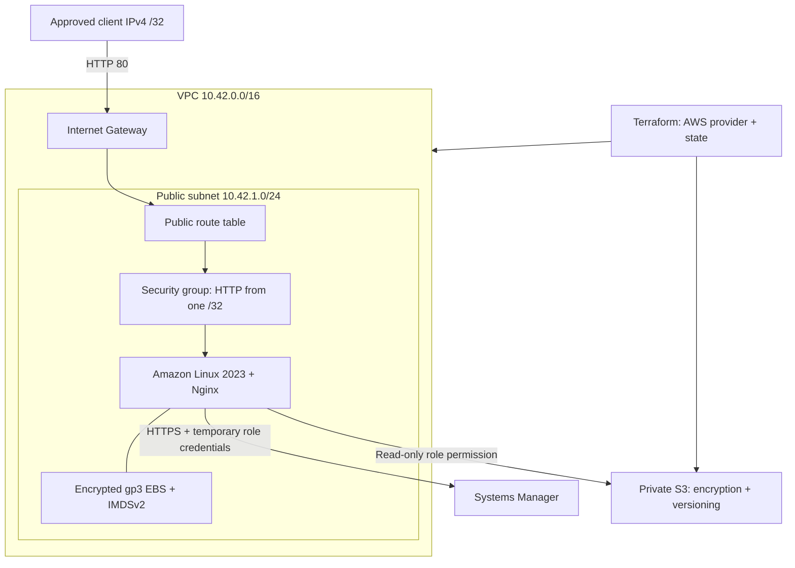
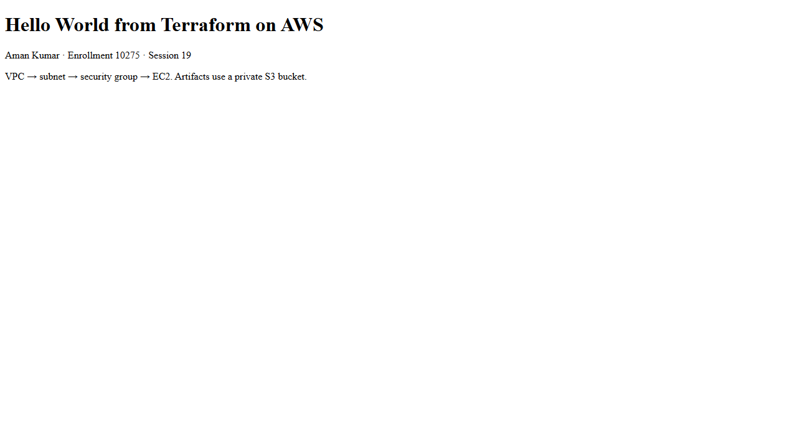
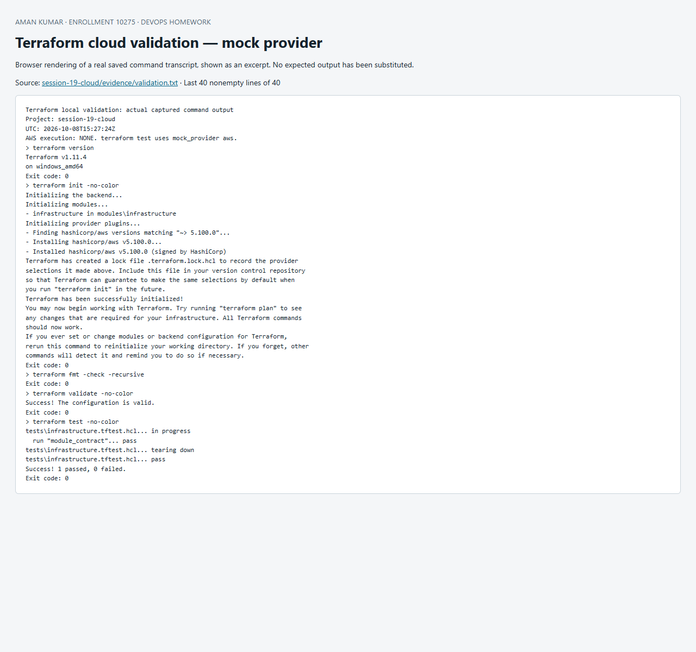
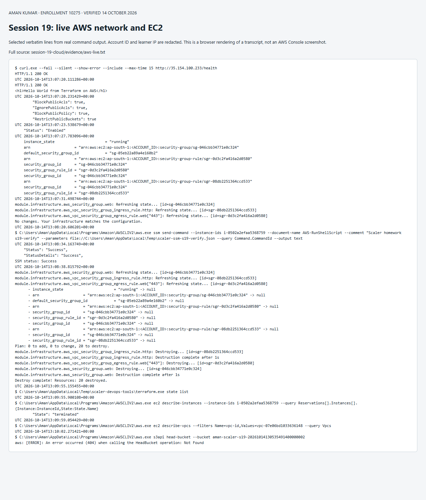

# Session 19 — Cloud & Terraform in Action

**Aman Kumar · Enrollment 10275**

This project provisions a complete learning network and Nginx host: VPC, subnet, Internet Gateway, routes, security group, EC2, instance role and private S3 artifact bucket. **Deployed, verified and cleaned up in AWS ap-south-1 on 14 October 2026.** Terraform created 20 resources, both HTTP checks passed, and Terraform subsequently destroyed all 20 resources. The historical website URL in the [live AWS transcript](evidence/aws-live.txt) is no longer a running deployment.

| Live verification | Recorded result |
| --- | --- |
| Terraform apply | 20 added, 0 changed, 0 destroyed |
| EC2 and metadata | `t3.micro` running; IMDSv2 tokens required |
| Systems Manager | Instance Online; remote verification command succeeded |
| Bootstrap and service | cloud-init `done`; Nginx `active`; localhost health `ok` |
| Public HTTP from the permitted client | `/health`: 200 and `ok`; `/`: 200 and `Hello World from Terraform on AWS` |
| Refresh plan | No changes; exit code 0 |
| Terraform cleanup | 20 destroyed; empty state |
| AWS cleanup checks | EC2 terminated, VPC query empty, bucket `HeadBucket` returned 404 |

Evidence is separated by what it proves: [live AWS deployment and HTTP checks](evidence/aws-live.txt), [local root validation/mock tests](evidence/validation.txt), and [module security tests](evidence/module-validation.txt). Mocked AMI/instance IDs, names and IP addresses are synthetic test data; the live transcript records actual AWS operations with account and learner-address redactions.

## Architecture



The subnet has a direct default route to the Internet Gateway. EC2 explicitly requests a public IP; the subnet does not automatically assign one to every future resource. No NAT Gateway, database, EKS cluster or load balancer is created. HTTP serves only a lab page; it is not an authenticated production endpoint.

## Terraform design

| Concept | Implementation |
| --- | --- |
| Provider | Pinned `hashicorp/aws` 5.100.x; Region and common tags in `provider.tf` |
| Variables | Region, project name, instance type and allowed client `/32` |
| Resources | Declarative VPC/network, EC2, IAM and S3 resources in `modules/infrastructure` |
| Data sources | Available AZs and public SSM parameter for the Amazon Linux 2023 x86_64 AMI |
| Outputs | VPC, subnet, EC2 ID, website URL and bucket name |
| Dependencies | Attribute references connect resources; explicit bootstrap dependencies wait for route association, SSM policy and egress rules |
| Reuse | The final project invokes the same module under a separate root and state |
| State | Local state tracks created IDs; it is ignored by Git and must be preserved securely until cleanup |

The instance requires IMDSv2 and encrypted EBS. The role allows Systems Manager and read-only access to its own bucket. The bucket has versioning, SSE-S3 encryption, ACLs disabled, all public access blocked and a TLS-only policy. `force_destroy=false` protects a non-empty bucket. No SSH key or AWS credential is embedded.

## Local validation

```powershell
cd session-19-cloud
terraform init
terraform fmt -check -recursive
terraform validate
terraform test
terraform -chdir=modules/infrastructure init
terraform -chdir=modules/infrastructure test
```

Root tests verify output wiring. Module tests verify network attachments, the restricted inbound rule, IMDSv2, encrypted EBS, private/versioned S3 and rejection of `0.0.0.0/0` or an incompatible ARM instance type. All tests use a mocked provider, so they check Terraform logic rather than AWS API authorization, image availability or network reachability. [HashiCorp provider mocking](https://developer.hashicorp.com/terraform/language/tests/mocking).

## Live deployment

Follow [AWS setup](../session-18-terraform/AWS-SETUP.md). From this directory create ignored `local.auto.tfvars` containing your real public IPv4 `/32`:

```hcl
allowed_http_cidr = "YOUR_PUBLIC_IPV4/32"
```

Replace the placeholder with a valid address; the checked-in default is a documentation address. The [credential helper](../scripts/terraform-login.py) supplies browser-login credentials privately to Terraform's child process and preserves its normal approval prompts. Run the following to reproduce the deployment:

```powershell
$env:AWS_PROFILE = 'scaler-lab'
$env:AWS_REGION = 'ap-south-1'
$awsCliPath = Join-Path $env:LOCALAPPDATA 'Programs/Amazon/AWSCLIV2/aws.exe'
& $awsCliPath login --profile scaler-lab --region ap-south-1
& $awsCliPath sts get-caller-identity
python ../scripts/terraform-login.py -- init
python ../scripts/terraform-login.py -- fmt -recursive
python ../scripts/terraform-login.py -- validate
python ../scripts/terraform-login.py -- plan '-out=live.tfplan'
python ../scripts/terraform-login.py -- show live.tfplan
python ../scripts/terraform-login.py -- apply live.tfplan
python ../scripts/terraform-login.py -- show
python ../scripts/terraform-login.py -- output
$instanceId = python ../scripts/terraform-login.py -- output -raw instance_id
$websiteUrl = python ../scripts/terraform-login.py -- output -raw website_url
& $awsCliPath ec2 wait instance-status-ok --instance-ids $instanceId
# Allow cloud-init to finish installing Nginx, then verify from the permitted IP.
curl.exe --fail --include "$websiteUrl/health"
curl.exe --fail --include $websiteUrl
& $awsCliPath ssm describe-instance-information --filters "Key=InstanceIds,Values=$instanceId"
python ../scripts/terraform-login.py -- plan -detailed-exitcode
```

The recorded page returned `Hello World from Terraform on AWS` with Aman Kumar's name and enrollment number; `/health` returned `ok`. Both requests received HTTP 200. [user-data.sh](modules/infrastructure/user-data.sh) installs Nginx and writes these responses. On a repeat run, EC2 status checks may pass before cloud-init finishes, so wait for the HTTP check as well.

This browser capture shows the real EC2-hosted page before the environment was removed:



For administrative access, install the official [Session Manager plugin](https://docs.aws.amazon.com/systems-manager/latest/userguide/session-manager-working-with-install-plugin.html), then:

```powershell
& $awsCliPath ssm start-session --target $instanceId
```

Inside the host inspect `sudo cloud-init status --wait`, `sudo journalctl -u nginx` and `curl http://localhost/health`. Use those checks to separate bootstrap failure from routing or client-IP issues.

## Evidence and cleanup

The [live transcript](evidence/aws-live.txt) records the reviewed plan, apply, outputs and application checks. Keep state, binary plans, local client-IP inputs and credentials outside Git. Use the same project directory and state for cleanup:

```powershell
# Leave the artifact bucket empty during this lab.
python ../scripts/terraform-login.py -- plan -destroy
python ../scripts/terraform-login.py -- destroy
python ../scripts/terraform-login.py -- state list
```

The completed run reported `Destroy complete! Resources: 20 destroyed.` and an empty `state list`. Independent AWS queries confirmed the instance was terminated, the VPC no longer existed and the bucket returned the expected 404. S3 object versions or objects must be deliberately removed before a non-empty bucket can be destroyed. Keep each root's state separate; Session 19 and the final wrapper are separate environments.

This is a single-AZ learning deployment. Session 19 serves the Nginx lab page; the [final project's Terraform root](../final-devops-project/terraform/README.md) reuses the infrastructure module with its own bootstrap and state.


## Screenshots of captured output

The two evidence screenshots below render excerpts from the linked command logs. The earlier image records local validation and mock tests; the live image records AWS deployment, application verification and cleanup. These are command-output captures, separate from the actual website capture above.




